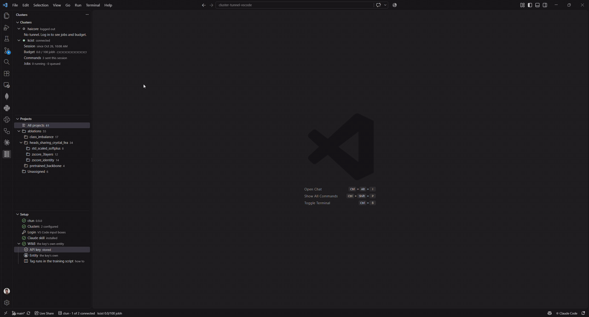
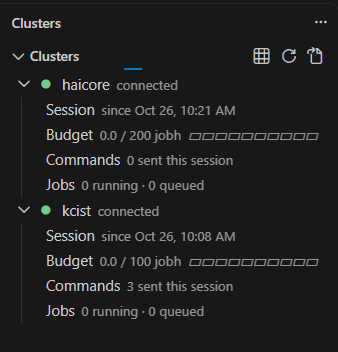
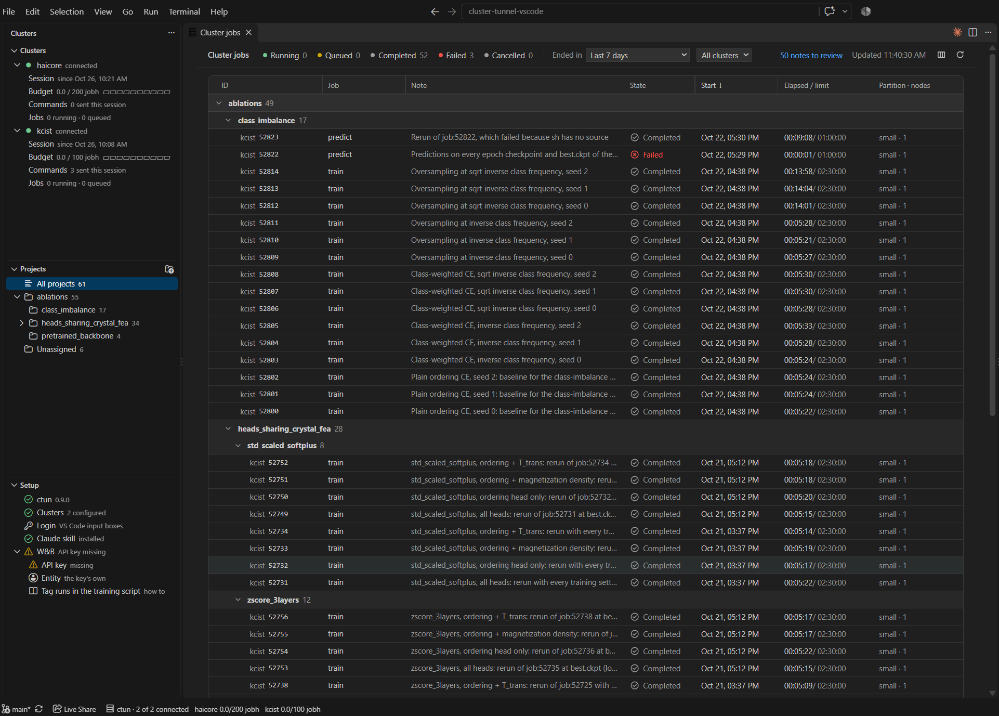
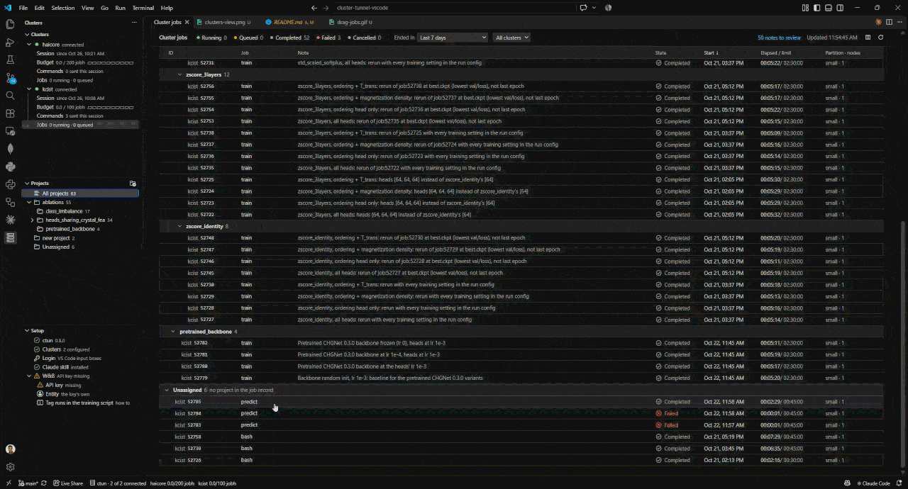
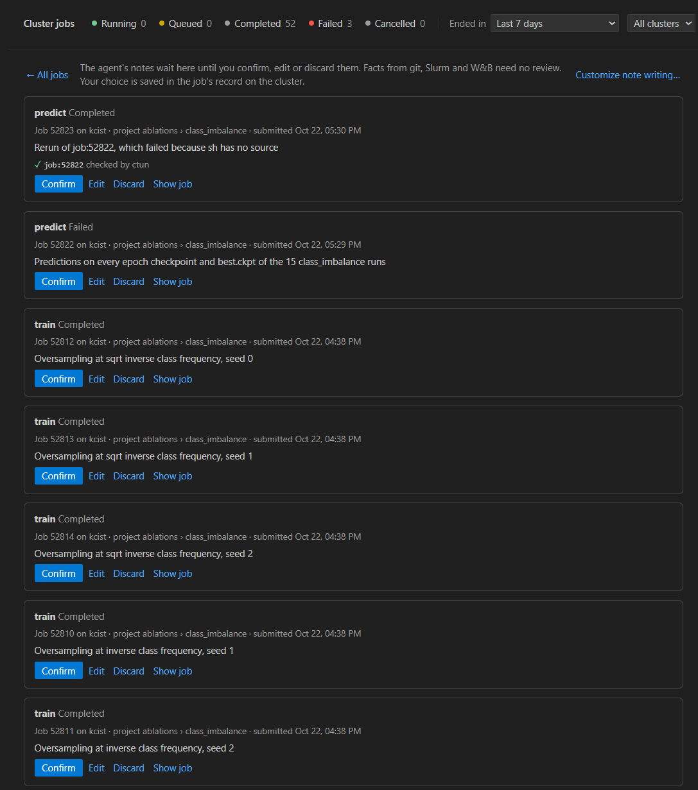
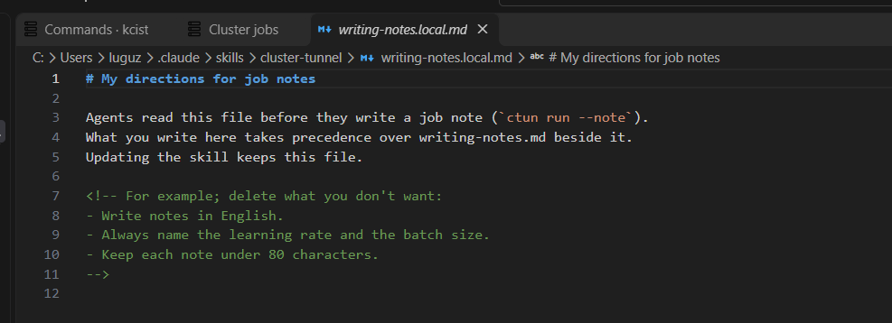
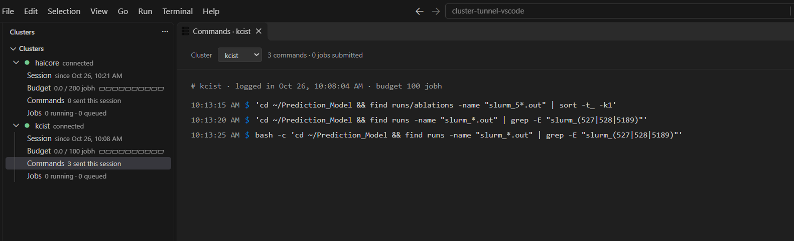
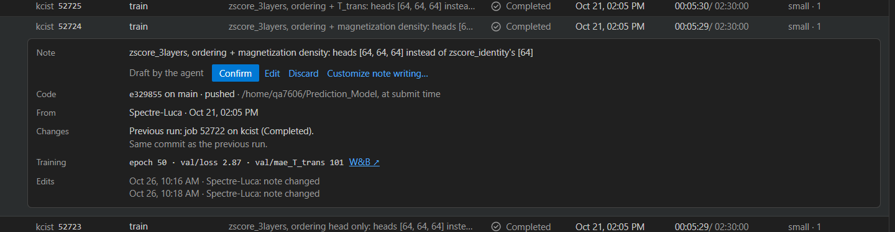

# Cluster Tunnel for VS Code

Your HPC clusters and Slurm jobs, inside VS Code. Log in with OTP, watch your jobs
on every cluster, sort them into projects and review the notes your agents write
about them.



The extension is a thin wrapper around the
[`ctun`](https://github.com/aimat-lab/cluster-tunnel) CLI. It has no SSH of its
own, and your password and OTP go straight to ctun's stdin.

## Quick start

1. **Install ctun** 0.9.0 or newer, as its
   [README](https://github.com/aimat-lab/cluster-tunnel) describes, and run
   `ctun config --init`. On Windows, ctun runs ssh inside WSL 2.
2. **Install the extension.** It is not on the Marketplace yet:

   ```bash
   code --install-extension cluster-tunnel-0.1.0.vsix
   ```

   Or in VS Code: open the Extensions view (`Ctrl+Shift+X`), click `…` at the
   top of it, choose **Install from VSIX…** and pick the file.

3. **Log in.** Open the ctun icon in the activity bar and click the login icon on
   a cluster's row.

The **Setup** view in the sidebar shows what is missing and fixes it in one click.

## Features

### Log in from VS Code

Each cluster shows its tunnel state, budget use and running / queued jobs. Log in
asks for budget, OTP and password in VS Code input boxes. `ctun login -i` from an
agent or terminal asks in the same window.



### All your jobs in one table

Jobs from every connected cluster, grouped by project, filtered by state, time
and cluster. Click a job to see the agent's note, the commit it ran, and the
commits since the previous run of the same job.



### Organize jobs into projects

Drag jobs onto a project, nest projects with `/`, rename them. The project is
stored in the job's record on the cluster, so every machine and agent sees it.



### Review agent notes

Agents write a note for each job they submit. **To review** shows the
unconfirmed ones as cards: confirm, edit or discard each one.



### Customize note writing

Tell agents how you want notes written, e.g. "always name the learning rate".
**Customize note writing…** (in review mode, on a draft note, or in the Command
Palette) opens `writing-notes.local.md` in ctun's Claude Code skill. Agents follow
it over the skill's own guide, and updating the skill keeps your file.



### See what was sent

The **Commands** tab lists every command sent to a cluster this session, with
the state of each submitted job.



### W&B training metrics

Turn on the W&B add-on to see each job's epoch and metrics next to it. Your
training script tags the run with its Slurm job:

```python
slurm_job_id = os.environ.get("SLURM_JOB_ID")
if slurm_job_id:
    run.tags = (*run.tags, f"slurm:{os.environ['SLURM_CLUSTER_NAME']}:{slurm_job_id}")
```

Full guide: [docs/wandb-tagging.md](docs/wandb-tagging.md), also **ctun: How to
Tag W&B Runs**.



## Settings

| Setting | Default | Meaning |
|---|---|---|
| `ctun.path` | `ctun` | The `ctun` executable, if it is not on `PATH`. |
| `ctun.login.method` | `vscode` | `vscode`: VS Code input boxes. `window`: ctun's own login window. |
| `ctun.addons.wandb.enabled` | `false` | Turns on the W&B add-on. |
| `ctun.addons.wandb.entity` | empty | W&B user or team to search; empty means the API key's own. |
| `ctun.addons.wandb.metrics` | `val/loss`, `val/mae_T_trans` | Metrics shown per run. |

## Development

```bash
npm install
npm test            # compile + unit tests (fixture JSON, no cluster)
npm run test:host   # starts a downloaded VS Code and activates the extension
npm run package     # builds cluster-tunnel-<version>.vsix
```

Press F5 to start an Extension Development Host. To install the extension into
your VS Code after every commit, run `git config core.hooksPath .githooks` once.

Branches: `main` works with the released ctun and gets published; `dev` adds
features that need unreleased ctun changes. See [PUBLISHING.md](PUBLISHING.md).
